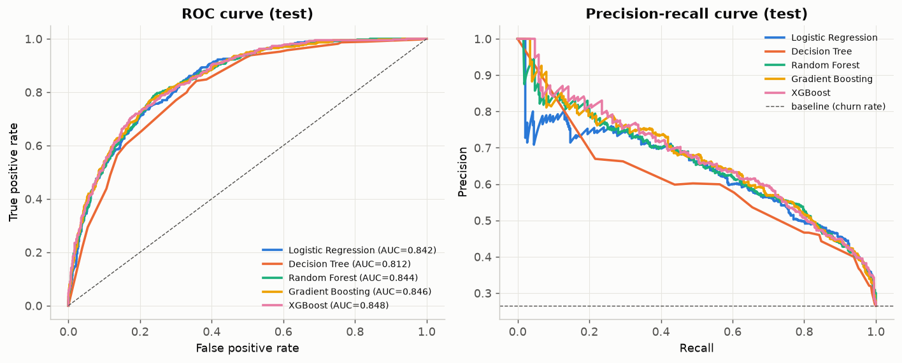
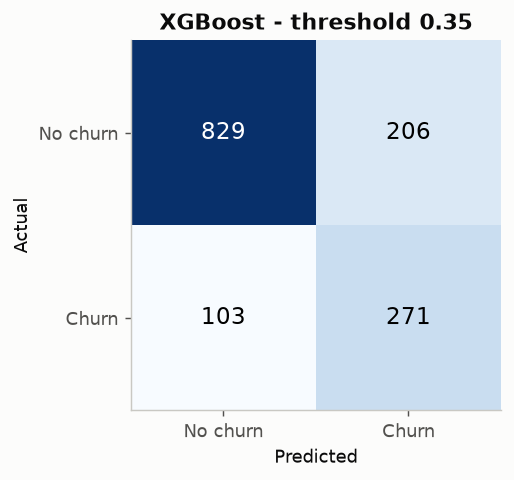
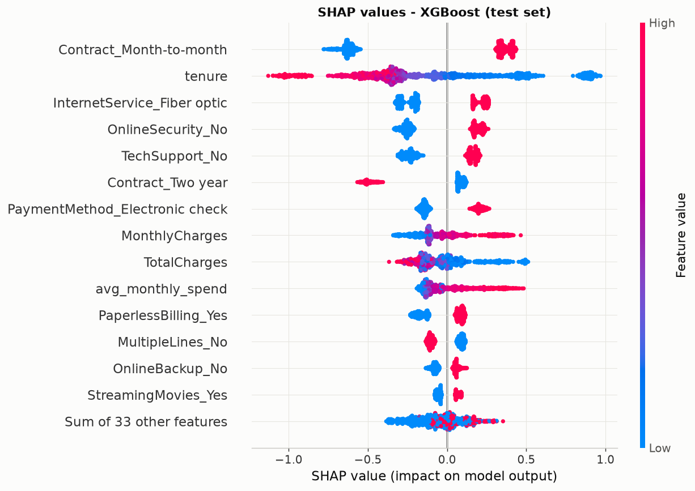
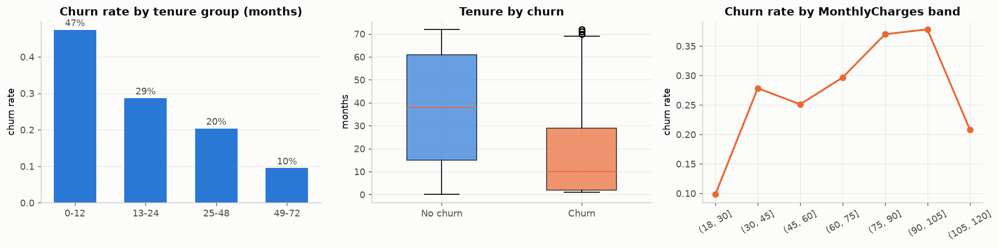
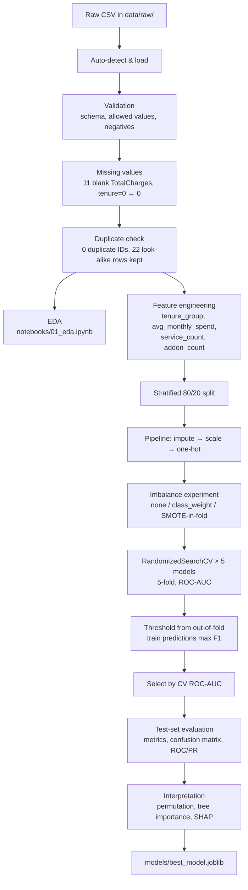
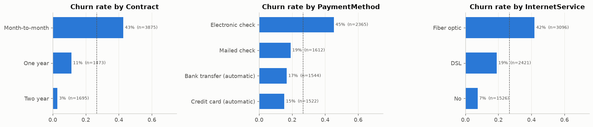
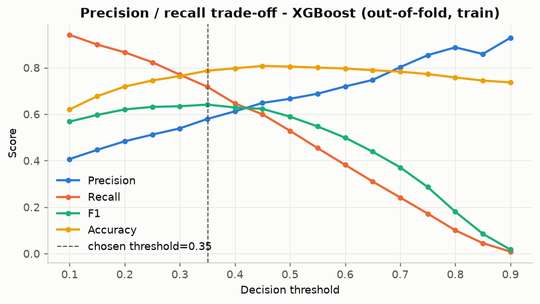
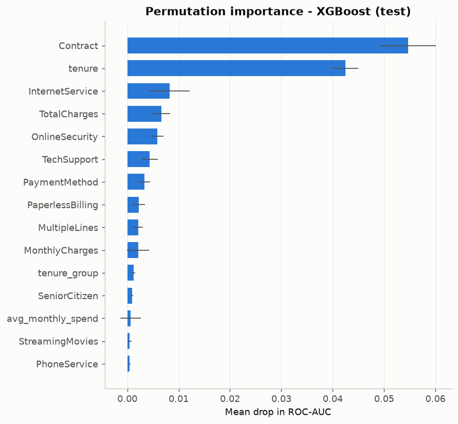

# Customer Churn Prediction using Machine Learning

*Machine Learning & Deep Learning Intern — G2RK IT Technologies Pvt Ltd*

A classification pipeline on tabular data that predicts which telecom customers will churn. It covers data validation,
cleaning, EDA, feature engineering, categorical encoding, a comparison of five classifiers, class-imbalance experiments,
hyperparameter tuning, threshold selection and model interpretation. Everything runs on a laptop CPU, and a full run takes
about 75 seconds.

All numbers below come from `python scripts/train.py` with `--seed 42`. The full log is in [reports/logs/train.log](reports/logs/train.log).

## Results at a glance

<table>
<tr><td width="50%"><br><sub>ROC and precision-recall curves, all five models (test set)</sub></td><td width="50%"><br><sub>XGBoost confusion matrix at the F1-optimal threshold</sub></td></tr>
<tr><td width="50%"><br><sub>SHAP: what drives the churn score</sub></td><td width="50%"><br><sub>Churn vs tenure and monthly charges</sub></td></tr>
</table>

All figures are in [`reports/figures/`](reports/figures/). Full training log: [`reports/logs/train.log`](reports/logs/train.log). Metrics: [`reports/metrics.json`](reports/metrics.json).

---

## 1. Problem

A subscription business loses revenue whenever a customer leaves. If at-risk customers can be found early, a retention team
can contact them before they cancel. The task is **binary classification**: predict `Churn` (Yes = 1 / No = 0) from a
customer's demographics, services and billing information.

Accuracy is a poor guide here. Only 26.5% of customers churn, so predicting "no churn" for everyone already scores 73.5%. The
project therefore focuses on **recall** (the share of churners caught), **precision** (the share of flagged customers who
really churn), **F1** and **ROC-AUC**.

## 2. Dataset

[IBM Telco Customer Churn](https://www.kaggle.com/datasets/blastchar/telco-customer-churn): 7,043 customers × 21 columns,
covering a fictional telco.

| Group | Columns |
|---|---|
| Demographics | `gender`, `SeniorCitizen`, `Partner`, `Dependents` |
| Account / billing | `tenure`, `Contract`, `PaperlessBilling`, `PaymentMethod`, `MonthlyCharges`, `TotalCharges` |
| Services | `PhoneService`, `MultipleLines`, `InternetService`, `OnlineSecurity`, `OnlineBackup`, `DeviceProtection`, `TechSupport`, `StreamingTV`, `StreamingMovies` |
| Target | `Churn` (Yes/No) |

The CSV is **not committed** (it is git-ignored). Run `python scripts/train.py --download`, or put the file in `data/raw/` under any
name; it is detected automatically. See [data/raw/README.md](data/raw/README.md).

## 3. Workflow



## 4. Data validation and preprocessing

| Check | Finding | Action |
|---|---|---|
| Schema (21 expected columns) | all present | — |
| Categorical values vs allowed set | no unexpected values | — |
| NaNs | none in the raw file | `SimpleImputer` (median / most-frequent) stays in the pipeline as a safeguard, fitted on training folds only |
| `TotalCharges` stored as text | 11 blank strings, **all with `tenure = 0`** | set to **0.0**: a new customer has not been billed yet, so 0 is the true value and no mean or median is imputed |
| Duplicate `customerID` | 0 | duplicate IDs would be dropped |
| Rows identical apart from ID | 22 | **kept**: these are different customers who share the same simple plan |
| `SeniorCitizen` | 0/1 integer | mapped to No/Yes and treated as categorical |
| Target | Yes/No | mapped to 1/0 |

**Encoding** happens inside a scikit-learn `ColumnTransformer`, so it is learned from training data only:
- numeric: median imputation, then `StandardScaler`
- categorical: most-frequent imputation, then `OneHotEncoder(drop="if_binary", handle_unknown="ignore")`. Yes/No columns
  become a single 0/1 column, and categories never seen in training are encoded as all zeros instead of raising an error.

## 5. Feature engineering

All engineered features are deterministic, per-row transforms with no fitted statistics, so creating them before the split
cannot leak information ([src/features.py](src/features.py)).

| Feature | Definition | Why |
|---|---|---|
| `tenure_group` | tenure in months binned 0-12 / 13-24 / 25-48 / 49-72 | churn is strongly non-linear in tenure: 47% → 29% → 20% → 10% |
| `avg_monthly_spend` | `TotalCharges / tenure`; equals `MonthlyCharges` when tenure = 0 | TotalCharges is roughly the sum of monthly bills, so the ratio is a well-defined average bill. It differs from the current bill when the price or plan changed |
| `service_count` | number of the 9 services held (phone, multiple lines, internet, 6 add-ons) | product engagement / switching cost |
| `addon_count` | number of the 6 internet add-ons | depth of the bundle beyond basic connectivity |

**Honest result:** an ablation in notebook 02 gives CV ROC-AUC 0.8508 ± 0.011 *with* these features and 0.8510 ± 0.012
*without* them, so there is no measurable effect. `avg_monthly_spend` is 0.996 correlated with `MonthlyCharges`. The features
are kept because they are cheap and easy for business users to read, not because they improve the score.

## 6. EDA highlights

Full analysis: [notebooks/01_eda.ipynb](notebooks/01_eda.ipynb). Figures are in `reports/figures/eda_*.png`.

| Attribute | Churn rate |
|---|---|
| Contract: month-to-month / one year / two year | **42.7%** / 11.3% / 2.8% |
| Tenure 0-12 months / 49-72 months | **47.4%** / 9.5% |
| Internet: fibre optic / DSL / none | **41.9%** / 19.0% / 7.4% |
| Payment: electronic check / other methods | **45.3%** / 15–19% |
| No OnlineSecurity / has it (internet customers) | **41.8%** / 14.6% |
| Senior citizen: yes / no | 41.7% / 23.6% |
| Gender: female / male | 26.9% / 26.2% (no signal) |

Median tenure is 10 months for churners and 38 months for retained customers.



## 7. Models, imbalance handling and tuning

Five models are trained in identical `Pipeline`s: **Logistic Regression, Decision Tree, Random Forest, Gradient Boosting
(scikit-learn) and XGBoost**. All of them use a CPU only.

**Class imbalance (26.5% positive).** The untuned models were compared in 5-fold CV on the training set:

| Model (untuned, threshold 0.5) | Recall: none → class_weight → SMOTE | ROC-AUC: none → class_weight → SMOTE |
|---|---|---|
| Logistic Regression | 0.534 → 0.796 → 0.787 | 0.846 → 0.846 → 0.844 |
| Random Forest | 0.482 → 0.654 → 0.570 | 0.827 → 0.828 → 0.824 |
| Gradient Boosting | 0.532 → n/a → 0.658 | 0.848 → n/a → 0.845 |
| XGBoost | 0.520 → 0.775 → 0.614 | 0.845 → 0.843 → 0.842 |

Without re-weighting, the models catch only about half of the churners at threshold 0.5. Class weights and SMOTE raise recall,
but **ROC-AUC does not change**: they move the operating point without improving the ranking. The pipeline therefore keeps
the unweighted models (unless a strategy improves CV ROC-AUC by more than 0.005) and handles the imbalance by **adjusting the
threshold**. SMOTE lives inside an `imblearn` Pipeline, so it only resamples the training folds and never touches validation
or test rows.

**Tuning:** `RandomizedSearchCV` runs 25 iterations with 5-fold stratified CV and ROC-AUC scoring over a small grid of the
parameters that matter most ([src/models.py](src/models.py)). Examples are `C` for logistic regression; depth and leaf size
for trees; and the number of trees, learning rate, depth, subsampling and regularisation for the boosted models.

**Threshold:** for each model, the threshold that maximises F1 on **out-of-fold training predictions** is selected. The test
set is never used to choose a model or a threshold.

## 8. Evaluation (held-out test set, 1,409 customers, 374 churners)

**Threshold 0.5**

| Model | Accuracy | Precision | Recall | F1 | ROC-AUC |
|---|---|---|---|---|---|
| Logistic Regression | 0.7999 | 0.6554 | 0.5187 | 0.5791 | 0.8421 |
| Decision Tree | 0.7771 | 0.5765 | 0.6043 | 0.5901 | 0.8117 |
| Random Forest | 0.7991 | 0.6667 | 0.4866 | 0.5626 | 0.8445 |
| Gradient Boosting | 0.8020 | 0.6632 | 0.5160 | 0.5805 | 0.8465 |
| **XGBoost (selected)** | 0.7991 | 0.6585 | 0.5053 | 0.5719 | **0.8476** |

**F1-optimal threshold, chosen on out-of-fold training predictions**

| Model | Threshold | Accuracy | Precision | Recall | F1 | ROC-AUC |
|---|---|---|---|---|---|---|
| Logistic Regression | 0.363 | 0.7757 | 0.5622 | 0.7005 | 0.6238 | 0.8421 |
| Decision Tree | 0.485 | 0.7580 | 0.5361 | 0.6551 | 0.5897 | 0.8117 |
| Random Forest | 0.333 | 0.7736 | 0.5542 | 0.7513 | 0.6379 | 0.8445 |
| Gradient Boosting | 0.320 | 0.7757 | 0.5585 | 0.7406 | 0.6368 | 0.8465 |
| **XGBoost (selected)** | 0.352 | 0.7807 | 0.5681 | 0.7246 | 0.6369 | 0.8476 |

**Selected model: XGBoost** (highest CV ROC-AUC, 0.851 ± 0.011). The four strong models are within 0.005 ROC-AUC of each
other, which is less than the fold-to-fold standard deviation, so the differences between them are not meaningful. Logistic
regression would be an equally defensible and more transparent choice.

**Accuracy is about 80%, not 85%.** No model in this setup reaches 85% accuracy on the test set, and the measured values are
reported as they are.

**Confusion matrix — XGBoost, test set** `[[TN, FP], [FN, TP]]`

| | threshold 0.50 | threshold 0.35 (F1-optimal) |
|---|---|---|
| matrix | `[[937, 98], [185, 189]]` | `[[829, 206], [103, 271]]` |
| churners caught | 189 / 374 (50.5%) | 271 / 374 (72.5%) |
| false alarms | 98 | 206 |



**Precision/recall trade-off.** Lowering the threshold from 0.50 to 0.35 catches 82 more churners at the cost of 108 more
false alarms. Which side matters more depends on cost. If a retention offer is cheap and a lost customer is expensive, a low
threshold that favours recall is best: at 0.30 the model catches 77% of churners while flagging 39% of customers. If the
intervention is expensive, a higher threshold keeps precision up. With real business costs, the threshold should be chosen to
minimise expected cost rather than to maximise F1.

## 9. Feature importance

Feature importance comes from three views: **permutation importance** (model-agnostic, computed on raw columns over the test
set), **XGBoost built-in importance** with **logistic-regression coefficients**, and **SHAP** (TreeExplainer).

| Rank | Feature | Permutation importance (drop in test ROC-AUC) |
|---|---|---|
| 1 | Contract | 0.0547 ± 0.0054 |
| 2 | tenure | 0.0424 ± 0.0025 |
| 3 | InternetService | 0.0082 ± 0.0039 |
| 4 | TotalCharges | 0.0066 ± 0.0017 |
| 5 | OnlineSecurity | 0.0058 ± 0.0012 |
| 6 | TechSupport | 0.0044 ± 0.0015 |
| 7 | PaymentMethod | 0.0033 ± 0.0012 |
| 8 | PaperlessBilling | 0.0022 ± 0.0012 |

SHAP agrees: the top attributions are `Contract_Month-to-month`, `tenure`, `InternetService_Fiber optic`,
`OnlineSecurity_No`, `TechSupport_No`, `Contract_Two year` and `PaymentMethod_Electronic check`. Gender, partner status and the
engineered count features contribute almost nothing.



**Association is not causation.** These importances show what the model *uses* to predict churn, not what *causes* churn.
For example, customers who plan to leave may simply avoid long contracts (reverse causality). Electronic-check payers may
differ in unobserved ways (confounding). Whether "move customers to annual contracts" reduces churn can only be answered with
an experiment such as an A/B test, not with feature importance.

## 10. Limitations

- **Single static snapshot** of a *fictional* company. There are no timestamps, so there is no temporal validation, no
  churn date and no way to model "churn in the next N days". Real churn models must be validated forward in time.
- **Small test set** (374 churners). Metric differences of about 0.01 are within noise.
- **Probabilities are not calibrated.** Calibrate them (e.g. with `CalibratedClassifierCV`) before using expected-value
  decisions.
- **F1 is a proxy objective.** The right threshold depends on retention cost and customer lifetime value, which this data
  does not include.
- **Little room for feature engineering** with this column set. Usage data, support tickets and billing history would likely
  help more than any tuning.
- Importance values are **associational** and unstable for collinear features (`MonthlyCharges` / `avg_monthly_spend` /
  `TotalCharges`).

## 11. Setup

```bash
cd customer_churn
python -m venv .venv
# Windows:  .venv\Scripts\activate
# macOS/Linux: source .venv/bin/activate
pip install -r requirements.txt
```

Python 3.10+ is required (tested on 3.12). XGBoost, imbalanced-learn and SHAP are optional: the pipeline skips XGBoost or
SMOTE when they are not installed.

## 12. Usage

```bash
# 1. Get the data (or place the CSV in data/raw/ manually)
python scripts/train.py --download          # downloads only if no CSV is found, then trains

# 2. Train / evaluate everything (~75 s on a laptop CPU)
python scripts/train.py

#    options
python scripts/train.py --quick                                   # 3-fold CV, 4 search iterations - smoke test
python scripts/train.py --models logistic_regression xgboost      # subset of models
python scripts/train.py --n-iter 40 --cv 5 --seed 7               # bigger search / other seed

# 3. Notebooks (run scripts/train.py first; notebook 02 reads its outputs)
jupyter lab notebooks/
#   or execute headless:
jupyter nbconvert --to notebook --execute --inplace notebooks/01_eda.ipynb
jupyter nbconvert --to notebook --execute --inplace notebooks/02_modeling.ipynb

# 4. Tests
python -m pytest -q
```

**Scoring a new customer**

```python
import joblib
import pandas as pd
from src.features import add_features
from src.preprocessing import select_features

art = joblib.load("models/best_model.joblib")        # {"pipeline", "threshold", ...}
customer = pd.DataFrame([{
    "gender": "Female", "SeniorCitizen": "No", "Partner": "No", "Dependents": "No",
    "tenure": 3, "PhoneService": "Yes", "MultipleLines": "No", "InternetService": "Fiber optic",
    "OnlineSecurity": "No", "OnlineBackup": "No", "DeviceProtection": "No", "TechSupport": "No",
    "StreamingTV": "Yes", "StreamingMovies": "No", "Contract": "Month-to-month",
    "PaperlessBilling": "Yes", "PaymentMethod": "Electronic check",
    "MonthlyCharges": 85.0, "TotalCharges": 255.0,
}])
p = art["pipeline"].predict_proba(select_features(add_features(customer)))[:, 1][0]
print(f"churn probability = {p:.2f}, flagged = {p >= art['threshold']}")
# -> churn probability = 0.76, flagged = True
```

## 13. Outputs

| Path | Content |
|---|---|
| `models/best_model.joblib` | fitted pipeline, decision threshold, feature list, sklearn version |
| `reports/metrics.json` | summary of the selected model: params, CV and test metrics, confusion matrices, top features |
| `reports/model_comparison.md` | all comparison tables in markdown |
| `reports/test_metrics_*.csv`, `cv_results.csv`, `imbalance_cv.csv` | raw result tables |
| `reports/permutation_importance.csv`, `model_importance_*.csv` | importance tables |
| `reports/figures/` | EDA plots, ROC/PR curves, confusion matrices, threshold trade-off, importances, SHAP |

## 14. Project structure

```
customer-churn-prediction/
├── .github/workflows/ci.yml  # runs the test suite on every push
├── data/raw/                 # put the CSV here (git-ignored, not committed)
├── notebooks/
│   ├── 01_eda.ipynb          # validation, missing values, duplicates, EDA, feature checks
│   └── 02_modeling.ipynb     # comparison, imbalance, thresholds, importance, SHAP, ablation
├── src/
│   ├── data.py               # auto-detect / download, validation, cleaning
│   ├── preprocessing.py      # column lists, ColumnTransformer
│   ├── features.py           # engineered features (documented)
│   ├── models.py             # model zoo, imbalance strategies, search spaces
│   └── evaluation.py         # metrics, threshold selection, plots, importance
├── scripts/
│   └── train.py              # end-to-end CLI pipeline
├── models/                   # best_model.joblib (written by training, not committed)
├── reports/                  # metrics.json, comparison tables
│   ├── figures/              # EDA, ROC/PR, confusion matrices, SHAP
│   └── logs/train.log        # full training log
├── tests/                    # pytest: data, features, preprocessing, models, end-to-end
├── requirements.txt
├── LICENSE
└── README.md
```
